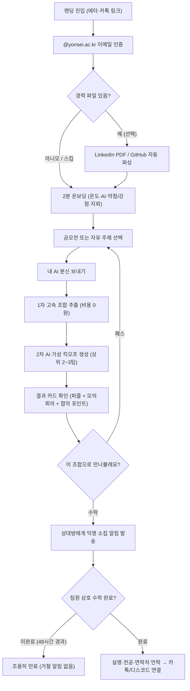

# 05. Workflow

> 유저가 처음 접속해 팀이 결성되기까지의 **유저 플로우**, 내부 **매칭·소집 상태 전이**, 그리고 해커톤 **개발 협업 워크플로우**를 정리한다.

---

## 1. End-to-End 유저 플로우



---

## 2. 팀 소집 상태 전이 (State Machine)

무거절 경험을 보장하기 위해 소집 상태는 아래 5단계로 엄격히 관리한다.

```text
SIMULATED ──▶ REQUESTED ──▶ WAITING_CONSENT ──▶ UNLOCKED (팀 확정)
                                  │
                                  └──▶ EXPIRED (48시간 경과 · 거절 알림 없음)
```

| 상태 | 설명 | 노출되는 정보 |
|---|---|---|
| `SIMULATED` | AI 모의회의 리포트 생성 완료 | 닉네임, 역할, 약점·강점, 모의회의 요약 |
| `REQUESTED` | 첫 번째 유저가 “만나볼래요” 클릭 | 선요청자 비공개, 나머지 멤버에게 알림 |
| `WAITING_CONSENT` | 일부 멤버 수락 대기 중 (최대 48시간) | 현재 수락 인원 수만 표시 *(예: 2/4 수락)* |
| `UNLOCKED` | 전원(또는 3인 이상) 수락 완료 | 실제 이름, 학과, 상세 프로필, 오픈채팅 링크 공개 |
| `EXPIRED` | 기한 내 미성사 또는 1명 이상 패스 | 당사자에게 거절 통보 없이 조용히 목록에서 종료 |

---

## 3. 매칭 운영 워크플로우 (상시 + 주간 드롭)

초기 유저 수가 적을 때 매칭이 비지 않도록 두 가지 트리거를 병행한다.

1. **상시 매칭 (On-Demand)**
   - 유저가 공모전을 선택하고 “내 AI 분신 보내기”를 누르면 즉시 시뮬레이션 실행
   - 같은 공모전에 대기 중인 풀 + 유사 관심사 풀에서 1차 조합을 뽑아 3~5초 내 결과 반환
2. **주간 팀 드롭 (Weekly Drop — 매주 금요일 밤 10시)**
   - 주중에 온보딩을 마친 전체 활성 유저를 대상으로 배치(Batch) 스코어링 실행
   - 최적의 4인 조합별 AI 모의회의 리포트를 일괄 생성해 이메일/카카오 알림 발송 → 동시 응답률 극대화

---

## 4. 해커톤 팀 개발 워크플로우

팀 저장소 `halieyyoon/yccthon_capybara` 기준의 안전한 병렬 작업 흐름이다.

1. **브랜치 규칙**: `main` 직접 작업 최소화 → 기능별 브랜치(`feat/onboarding`, `feat/ai-sim`, `feat/matching-ui`)에서 작업 후 짧은 PR로 병합
2. **작업 순서 (의존성 최소화)**
   - **Step 1 (공통 합의)**: 온보딩 Taxonomy(JSON 상수) + DB 스키마 + API 입출력 JSON 계약 확정
   - **Step 2 (병렬 개발)**
     - 프론트엔드: 온보딩 4단계 + 결과 카드 UI (목업 JSON으로 선개발)
     - 백엔드/AI: 1차 스코어링 함수 + Gemini Flash 가상 킥오프 프롬프트 API
   - **Step 3 (통합 & 시드 데이터)**: 연세대 가상 페르소나 20명 + 실제 공모전 10건 시드 투입 후 전체 흐름 시연 검증
