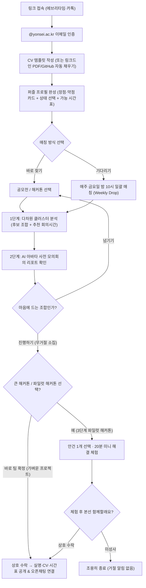

# 05. Workflow

> 사용자가 들어와 **퍼즐 프로필·CV 작성 → 3단계 매칭 → 최종 팀 확정**까지 거치는 전체 흐름과 개발 협업 순서를 정리한다.

---

## 1. 전체 이용 흐름



---

## 2. 팀 확정 상태 흐름

```text
1단계 클러스터 추출 ──▶ 2단계 AI 아바타 완료 ──▶ 소집 대기 ──▶ (선택) 3단계 20분 파일럿 ──▶ 팀 확정 (실명·CV 공개)
                                                    │                                              │
                                                    └──────────────▶ 기간 만료 (거절 알림 없음) ◀──┘
```

| 내부 상태값 | 뜻 | 화면에 보이는 정보 |
|---|---|---|
| `CLUSTERED` | 1단계 다차원 클러스터 분석 완료 | 후보 조합 점수, 퍼즐 맞물림, 추천 정기 회의 시간 |
| `AVATAR_DONE` | 2단계 AI 아바타 모의회의 완료 | 닉네임, 퍼즐 모양, 모의회의 요약 4~5줄, 합의 포인트 |
| `PILOT_ACTIVE` | 3단계 20분 파일럿 해커톤 진행 중 | 선택 안건, 20분 타이머, 실시간 미니 메모/채팅 |
| `WAITING_CONSENT` | 최종 수락 응답 대기 중 | 누가 먼저 눌렀는지 비공개, 현재 수락 인원 수만 표시 |
| `UNLOCKED` | 상호 수락 완료 (팀 확정) | 실명, 학과, CV 템플릿, 4인 시간표 겹침 표, 오픈채팅 링크 |
| `EXPIRED` | 미성사 또는 기한 만료 | 거절 알림 없이 조용히 종료 |

---

## 3. 매칭 운영 방식 (상시 + 매주 금요일 일괄 매칭)

1. **상시 매칭**: 사용자가 공모전/해커톤을 선택하면 즉시 1단계 클러스터 분석 + 2단계 AI 아바타 모의회의 실행
2. **매주 금요일 일괄 매칭 (Weekly Drop — 금요일 밤 10시)**: 주중에 퍼즐 프로필을 활성화한 참여자들을 한꺼번에 클러스터링해 최적 조합과 정기 회의 추천 시간을 동시 알림 발송 → 초기 참여자가 적을 때도 높은 응답률 확보

---

## 4. 해커톤 팀 개발 협업 순서

팀 저장소 `halieyyoon/yccthon_capybara` 기준의 병렬 개발 흐름이다.

1. **브랜치 규칙**: `main` 직접 수정 최소화 → 기능별 브랜치(`feat/puzzle-profile`, `feat/cv-template`, `feat/cluster-avatar`, `feat/pilot-room`)로 나눠 작업 후 짧은 PR 병합
2. **작업 순서**
   - **Step 1 (공통 약속 확정)**: 장점·약점 퍼즐 카드 목록(16종 등), 상태별 디자인 매트릭스, CV 템플릿 필드, DB 테이블 확정
   - **Step 2 (병렬 개발)**
     - 프론트엔드: 퍼즐 프로필(상태별 디자인 변화) + CV 템플릿 에디터 + 20분 파일럿 해커톤 방
     - 백엔드/AI: 1단계 다차원 클러스터 분석 + 시간표 교집합 + 2단계 AI 아바타 JSON 생성 API + PDF 파싱
   - **Step 3 (통합 시연)**: 연세대 가상 페르소나 20명 + 예시 공모전 10건 투입 후 1→2→3단계 전체 흐름 시연 점검
