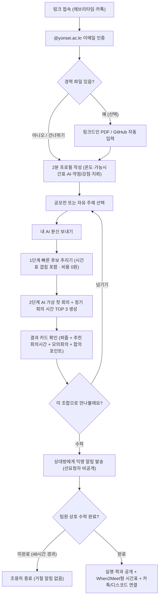

# 05. Workflow

> 사용자가 처음 들어와 팀을 확정하기까지의 **이용 흐름**, **팀 수락 진행 단계**, **매주 금요일 일괄 매칭 방식**, 그리고 **팀 개발 협업 순서**를 정리한다.

---

## 1. 전체 이용 흐름



---

## 2. 팀 수락 진행 단계

거절 스트레스 없이 팀이 확정되도록 상태를 5단계로 관리한다.

```text
모의회의 완료 ──▶ 첫 수락 요청 ──▶ 팀원 응답 대기 ──▶ 팀 확정 (실명 공개)
                                        │
                                        └──▶ 기간 만료 (48시간 경과 · 거절 알림 없음)
```

| 내부 상태값 | 뜻 | 화면에 보이는 정보 |
|---|---|---|
| `SIMULATED` | AI 모의회의 리포트 생성 완료 | 닉네임, 역할, 약점·강점, 추천 회의시간, 모의회의 요약 |
| `REQUESTED` | 첫 번째 사람이 “만나볼래요” 클릭 | 누가 먼저 눌렀는지 비공개, 나머지 멤버에게 알림 |
| `WAITING_CONSENT` | 나머지 팀원 응답 대기 중 (최대 48시간) | 현재 수락 인원 수만 표시 *(예: 2/4 수락)* |
| `UNLOCKED` | 전원(또는 3인 이상) 수락 완료 | 실제 이름, 학과, 4인 시간표 겹침, 오픈채팅 링크 공개 |
| `EXPIRED` | 기한 내 미성사 또는 1명 이상 넘기기 | 거절 통보 없이 조용히 목록에서 종료 |

---

## 3. 매칭 운영 방식 (상시 + 매주 금요일 일괄 매칭)

초기 참여자가 적을 때도 매칭이 비지 않도록 두 방식을 함께 돌린다.

1. **상시 매칭 (원할 때 바로 돌리기)**
   - 사용자가 공모전을 고르고 “내 AI 분신 보내기”를 누르면 즉시 시뮬레이션 실행
   - 같은 공모전 대기자 및 유사 관심사 인원 중에서 후보를 뽑아 3~5초 내 결과 표시
2. **매주 금요일 일괄 매칭 (금요일 밤 10시)**
   - 월~금 사이에 프로필을 작성한 전체 활성 참여자를 한꺼번에 매칭
   - 최적의 4인 조합별 AI 모의회의 리포트와 **정기 회의 추천 시간 TOP 3**를 금요일 밤 10시에 동시 알림 발송 → 모두가 같은 시각에 확인해 빠른 수락 유도

---

## 4. 해커톤 팀 개발 협업 순서

팀 저장소 `halieyyoon/yccthon_capybara` 기준의 병렬 개발 흐름이다.

1. **브랜치 규칙**: `main` 직접 수정 최소화 → 기능별 브랜치(`feat/onboarding`, `feat/ai-sim`, `feat/matching-ui`)에서 작업 후 짧은 PR로 병합
2. **작업 순서 (서로 기다리지 않도록 분리)**
   - **Step 1 (공통 약속 먼저 확정)**: 온보딩 선택지 목록 + DB 테이블 구조 + API 주고받을 JSON 형식 확정
   - **Step 2 (동시 개발)**
     - 프론트엔드: 2분 프로필 작성 + 가능 시간표 드래그 + 결과 카드 화면 (임시 예시 데이터로 먼저 구현)
     - 백엔드/AI: 1단계 점수 계산·시간표 교집합 함수 + Gemini Flash 가상 회의 생성 API
   - **Step 3 (합치기 & 예시 데이터 투입)**: 연세대 가상 학생 20명 + 실제 공모전 10건 예시 데이터를 넣어 처음부터 끝까지 시연 검증
