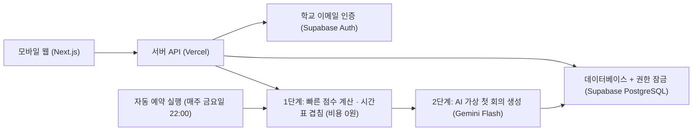

# 07. Tech Architecture 제안

> **설계 목표**  
> 해커톤과 초기 연세대 런칭(50~500명)을 **적은 인원과 적은 비용으로 빠르게 구현**하면서도, AI 응답 속도와 개인정보 보호(수락 전 실명 비공개)를 확실하게 지키는 구조다.

---

## 1. 전체 시스템 흐름



---

## 2. MVP 권장 기술 스택

| 영역 | 추천 기술 | 선택한 이유 |
|---|---|---|
| **화면(Frontend)** | **Next.js (App Router) + TypeScript + Tailwind CSS** | 모바일 웹에 강하고, 카톡·에타 링크 미리보기 지원, 화면과 서버 API를 한 프로젝트에서 빠르게 개발 |
| **서버 DB & 인증** | **Supabase (PostgreSQL + Auth + RLS)** | `@yonsei.ac.kr` 이메일 인증을 빠르게 붙이고, DB 권한 잠금(RLS)으로 수락 전 실명 노출을 원천 차단 |
| **AI 모델** | **Gemini 2.5 Flash** *(또는 GPT-4o-mini)* | 2~4초 내 빠른 응답, 정해진 JSON 형식으로 안정적 출력, 조합 1개당 몇 원 수준의 초저비용 |
| **이력서 PDF 읽기** | `pdf-parse` / LLM 문서 입력 | 링크드인 PDF·이력서에서 경력·기술 초안을 자동 추출 |
| **배포 & 자동 실행** | **Vercel + Vercel Cron** | GitHub에 올리면 자동 배포, 매주 금요일 밤 10시 일괄 매칭 자동 실행 |

---

## 3. 핵심 DB 테이블 구조 (5개)

```sql
-- 1. 사용자 계정 (실명·연락처 — 서로 수락하기 전까지 타인에게 비공개)
users (
  id uuid primary key,
  email text unique not null,         -- @yonsei.ac.kr 확인
  real_name text not null,
  major text not null,
  contact_link text,                  -- 오픈채팅/카톡 ID 등 (팀 확정 시에만 공개)
  created_at timestamptz default now()
)

-- 2. 매칭용 익명 프로필 (2분 온보딩 입력값)
profiles (
  user_id uuid primary key references users(id),
  nickname text not null,
  temperature int not null,           -- 36(편함) | 65(균형) | 90(진지)
  weekly_hours text not null,         -- '3-5h' | '6-10h' | '10h+'
  available_slots jsonb not null,     -- 요일×시간대 가능 시간표 (When2Meet형 추천용)
  ai_style text not null,             -- 'ai_accelerator' | 'ai_verifier' | 'manual_first'
  weaknesses text[] not null,         -- 약점 카드 2장
  strengths text[] not null,          -- 강점 카드 2장
  deal_breakers text[] not null,      -- 협업 지뢰 1~2개
  career_summary jsonb,               -- (선택) PDF/GitHub 자동 정리 결과
  is_active boolean default true
)

-- 3. 공모전 / 프로젝트 주제
contests (
  id uuid primary key,
  title text not null,
  category text not null,             -- 'it_hackathon' | 'business' | 'design' | 'free'
  deadline date,
  summary text,
  required_roles text[]
)

-- 4. AI 분신 가상 첫 회의 결과 (중복 AI 호출 방지용 저장)
team_simulations (
  id uuid primary key,
  contest_id uuid references contests(id),
  member_ids uuid[] not null,         -- 정렬된 3~4인 ID 목록 (같은 조합 재사용 키)
  stage1_score numeric not null,
  recommended_meeting_slots jsonb not null, -- 4인 모두 가능한 정기 회의 추천 시간 TOP 3
  puzzle_summary jsonb not null,      -- 약점↔강점 보완 정리
  meeting_highlights jsonb not null,  -- 4~6턴 가상 회의 요약
  alignment_tip text not null,        -- 첫 회의 합의 포인트 1줄
  status text default 'SIMULATED',    -- SIMULATED | REQUESTED | WAITING_CONSENT | UNLOCKED | EXPIRED
  expires_at timestamptz,
  created_at timestamptz default now()
)

-- 5. 무거절 수락 응답 기록
team_consents (
  simulation_id uuid references team_simulations(id),
  user_id uuid references users(id),
  decision text not null,             -- 'PENDING' | 'ACCEPTED' | 'PASSED'
  updated_at timestamptz default now(),
  primary key (simulation_id, user_id)
)
```

---

## 4. 2단계 AI 매칭 방식 (속도·비용 통제)

모든 인원 조합에 AI를 돌리면 느리고 비용이 커지므로, **계산(1단계)과 AI 생성(2단계)**을 나눈다.

### 1단계. 빠른 후보 조합 추리기 (비용 0원, 0.05초 이내)
요청자를 포함한 후보 풀에서 3~4인 조합 점수를 계산해 **상위 2~3팀만** 뽑는다.

```text
조합 점수 = (참여 온도 일치 × 30)
          + (가능 시간표 겹침 / 정기 회의 시간 확보 × 20)
          + (약점↔강점 서로 보완 × 35)
          + (AI 활용 스타일 조화 × 15)
          − (협업 지뢰 충돌 × 40)
```
- **정기 회의 시간 자동 추천 (비용 0원)**: 4명의 `available_slots`에서 **전원이 연속 1~2시간 이상 가능한 시간대**를 찾아 상위 3개(`recommended_meeting_slots`)를 자동 저장한다.

### 2단계. AI 가상 첫 회의 생성 (조합당 1회 호출)
- AI 4개를 따로 주고받게 하면 느리므로, **정해진 JSON 형식으로 1번만 호출**해 4인의 6턴 가상 대화·요약·합의 포인트를 한 번에 만든다.
- **결과 재사용(캐싱)**: `공모전 ID + 정렬된 멤버 ID 목록`을 기준으로 저장해 두어, 같은 조합의 다른 팀원이 확인할 때는 AI를 다시 부르지 않고 즉시 보여준다.
- **예상 비용**: 조합 1개당 약 1~5원 수준으로, 초기 200명 운영 시 한 달 커피 한 잔 이하 비용으로 감당 가능하다.

---

## 5. 개인정보 보호 및 안전장치

1. **학교 이메일 제한**: 가입 시 `@yonsei.ac.kr` 주소 인증 필수 (타 대학 확장 시 허용 학교 목록에 추가)
2. **수락 전 실명 접근 원천 차단 (Supabase RLS)**: `team_simulations.status = 'UNLOCKED'`이고 본인이 속한 팀일 때만 `users` 테이블의 실명·연락처를 읽을 수 있도록 DB 권한으로 잠금
3. **AI 모의회의 안내 문구**: 결과 화면 하단에 *“입력한 성향을 바탕으로 AI가 만든 가상 회의 미리보기”*임을 명시
4. **자유 입력 보안**: 직접 입력하는 약점·지뢰 문구는 40자 이내로 제한하고, AI 프롬프트에 일반 텍스트가 아닌 데이터 필드로 분리해 전달
