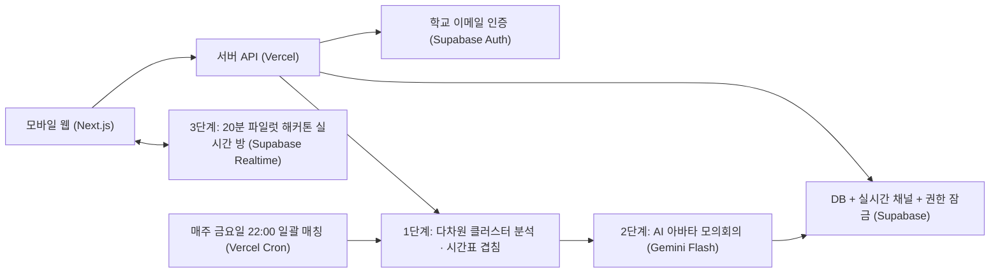

# 07. Tech Architecture 제안

> **설계 목표**  
> 확정된 **3단계 매칭(다차원 클러스터 분석 → AI 아바타 → 20분 파일럿 해커톤)**, **퍼즐 프로필(+주간 일괄 매칭)**, **CV 템플릿**을 해커톤~초기 연세대 런칭 규모(50~500명)에서 빠르고 저렴하게 구현하는 구조다.

---

## 1. 전체 시스템 흐름



---

## 2. MVP 권장 기술 스택

| 영역 | 추천 기술 | 선택한 이유 |
|---|---|---|
| **화면(Frontend)** | **Next.js (App Router) + TypeScript + Tailwind CSS** | 모바일 웹 최적화, 상태별 퍼즐 UI 구현 간편, 화면·API 한 레포 통합 개발 |
| **DB · 인증 · 실시간** | **Supabase (PostgreSQL + pgvector + Auth + Realtime + RLS)** | `@yonsei.ac.kr` 인증, 벡터 저장(`pgvector`), **20분 파일럿 해커톤 실시간 채팅/메모(`Realtime`)**, 수락 전 실명 차단(`RLS`)을 하나로 해결 |
| **1단계 클러스터 분석** | **TypeScript 벡터/클러스터 모듈** *(또는 경량 Python FastAPI 마이크로서비스)* | 다차원 피처(온도·시간·장단점·AI 스타일·지뢰) 벡터화 + 코사인 유사도/보완 매트릭스 + 클러스터링 계산 |
| **2단계 AI 아바타 & CV 파싱** | **Gemini 2.5 Flash** *(또는 GPT-4o-mini)* | 2~4초 내 정해진 JSON으로 가상 회의 생성 + 링크드인 PDF·이력서 → CV 템플릿 자동 추출 |
| **배포 & 일괄 매칭** | **Vercel + Vercel Cron** | GitHub 푸시 자동 배포, 매주 금요일 밤 10시 일괄 매칭(Weekly Drop) 자동 실행 |

---

## 3. 핵심 DB 테이블 구조 (6개)

```sql
-- 1. 사용자 계정 (실명·연락처 — 팀 확정 전까지 타인에게 비공개)
users (
  id uuid primary key,
  email text unique not null,           -- @yonsei.ac.kr 인증
  real_name text not null,
  major text not null,
  contact_link text,
  created_at timestamptz default now()
)

-- 2. 퍼즐 프로필 & 다차원 벡터 (기능 2 + 기능 1의 1단계 입력)
profiles (
  user_id uuid primary key references users(id),
  nickname text not null,
  profile_mode text not null,           -- 'fun_explore' | 'award_career' (퍼즐 디자인 테마 결정)
  temperature int not null,             -- 36 | 65 | 90
  weekly_hours text not null,           -- '3-5h' | '6-10h' | '10h+'
  available_slots jsonb not null,       -- 요일×시간대 가능 시간표 (When2Meet형)
  ai_style text not null,               -- 'ai_accelerator' | 'ai_verifier' | 'manual_first'
  strength_cards text[] not null,       -- 장점 퍼즐 카드 (예: 16종 중 선택)
  weakness_cards text[] not null,       -- 약점 퍼즐 카드
  deal_breakers text[] not null,        -- 협업 지뢰
  feature_vector vector(64),            -- 1단계 다차원 클러스터 분석용 수치 벡터
  cluster_id int,                       -- 최신 클러스터 소속 ID
  weekly_drop_opt_in boolean default true
)

-- 3. CV 템플릿 (기능 3)
cv_templates (
  user_id uuid primary key references users(id),
  headline text,
  experiences jsonb default '[]',       -- 프로젝트·공모전·동아리 이력
  skills text[] default '{}',           -- 언어·툴·직군
  ai_tools text[] default '{}',         -- 주로 쓰는 AI 툴 및 활용 방식
  collaboration_notes text,             -- 협업 성향 서술
  source_parsed_from text,              -- 'manual' | 'linkedin_pdf' | 'github'
  updated_at timestamptz default now()
)

-- 4. 공모전 / 해커톤 주제 (규모에 따라 파일럿 해커톤 옵션 표시 여부 결정)
contests (
  id uuid primary key,
  title text not null,
  scale text not null,                  -- 'small' | 'large' (large일 때 3단계 파일럿 옵션 강조)
  deadline date,
  pilot_topics jsonb default '[]'       -- 3단계 20분 파일럿 해커톤용 안건 목록
)

-- 5. 1단계 클러스터 + 2단계 AI 아바타 결과 (캐싱 단위)
team_simulations (
  id uuid primary key,
  contest_id uuid references contests(id),
  member_ids uuid[] not null,           -- 정렬된 3~4인 ID (중복 AI 호출 방지 키)
  cluster_score numeric not null,
  puzzle_fit jsonb not null,            -- 4인 퍼즐 맞물림 구조
  recommended_meeting_slots jsonb not null, -- 4인 교집합 정기 회의 추천 시간 TOP 3
  avatar_meeting jsonb not null,        -- 2단계 AI 아바타 6턴 모의회의 하이라이트
  alignment_tip text not null,
  status text default 'AVATAR_DONE',    -- CLUSTERED | AVATAR_DONE | PILOT_ACTIVE | WAITING_CONSENT | UNLOCKED | EXPIRED
  expires_at timestamptz,
  created_at timestamptz default now()
)

-- 6. 3단계 파일럿 해커톤 방 & 최종 상호 수락 기록
pilot_sessions (
  simulation_id uuid primary key references team_simulations(id),
  selected_topic text not null,
  started_at timestamptz,
  ends_at timestamptz,                  -- 시작 후 +20분 타이머
  shared_notes text default '',         -- 20분 협업 미니 메모
  consents jsonb default '{}'           -- { user_id: 'PENDING' | 'ACCEPTED' | 'PASSED' }
)
```

---

## 4. 3단계 매칭 엔진 기술 상세

### 1단계. High-Dimensional Cluster Analysis (비용 0원)
- **피처 인코딩**: `profile_mode`, `temperature`, `weekly_hours`, `available_slots`(요일×시간 비트 벡터), `ai_style`, `strength_cards`/`weakness_cards`(원-핫 + 보완 매트릭스), `deal_breakers`를 하나의 다차원 수치 벡터(`feature_vector`)로 변환한다.
- **클러스터링 & 보완 조합 추출**:
  1. **유사 차원(온도·시간표·목표 모드)**으로 먼저 클러스터링해 “같은 결의 집단”을 묶는다.
  2. 같은 클러스터 안에서 **상보 차원(장점↔약점 퍼즐 맞물림)**을 최대화하고 **협업 지뢰 충돌**을 감점해 상위 2~3개 4인 조합을 추출한다.
  3. 4인의 `available_slots` 교집합에서 **연속 1~2시간 이상 전원 가능한 시간 TOP 3**를 자동 계산한다.

### 2단계. AI 아바타 모의회의 (조합당 1회 호출)
- 상위 2~3개 조합에 대해서만 **정해진 JSON 형식으로 LLM 1회 호출** → 4인 AI 아바타의 6턴 가상 회의와 합의 포인트 생성.
- `contest_id + 정렬된 member_ids` 키로 저장해 재사용하므로 조합당 몇 원 수준의 초저비용으로 운영 가능하다.

### 3단계. 20분 파일럿 해커톤 (실시간 경량 방)
- 복잡한 화이트보드 대신 **Supabase Realtime Broadcast/Presence** 기반의 `20분 카운트다운 타이머 + 공유 텍스트 메모 + 실시간 채팅`으로 가볍게 구현한다.
- 20분 종료 시 자동으로 비공개 투표 모달이 뜨고, 상호 수락 시 `status = 'UNLOCKED'`로 전환된다.

---

## 5. 개인정보 보호 및 안전장치

1. **학교 이메일 인증**: `@yonsei.ac.kr` 도메인 검증 필수
2. **수락 전 실명·CV 접근 원천 차단 (Supabase RLS)**: `team_simulations.status = 'UNLOCKED'`이고 본인이 멤버일 때만 `users`의 실명·연락처와 타인의 `cv_templates` 상세 조회 허용
3. **AI 안내 및 입력 보호**: AI 아바타 모의회의는 입력 데이터 기반 시뮬레이션임을 표기하고, 자유 입력은 40자 제한 및 데이터 필드 분리로 프롬프트 오염 방지
