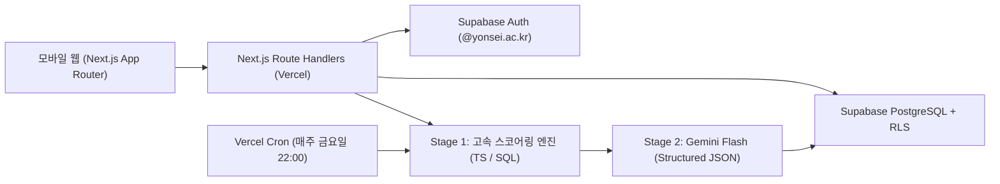

# 07. Tech Architecture 제안

> **설계 목표**  
> 해커톤~초기 연세대 런칭(유저 50~500명)을 **최소 인원·최소 비용으로 빠르게 구현**하면서도, AI 응답 속도와 개인정보 보호(언락 전 실명 비공개)를 탄탄하게 보장하는 경량 아키텍처다.

---

## 1. 전체 시스템 구조



---

## 2. MVP 권장 기술 스택

| 영역 | 추천 기술 | 선정 이유 |
|---|---|---|
| **Frontend** | **Next.js (App Router) + TypeScript + Tailwind CSS** | 모바일 웹 최적화, OG 태그 공유(에타/카톡), 프론트·API 단일 레포 개발 |
| **Backend / DB** | **Supabase (PostgreSQL + Auth + RLS)** | 이메일 매직링크/OTP 인증 즉시 구현, Row Level Security로 신원 비공개 보안 간편 |
| **AI 모델** | **Gemini 2.5 Flash** *(또는 GPT-4o-mini)* | 빠른 응답(2~4초), Structured JSON 출력 안정적, 조합당 수십 원 이하 초저비용 |
| **PDF 파싱** | `pdf-parse` / LLM 문서 입력 | LinkedIn PDF·이력서 텍스트 추출 → 프로필 JSON 자동 변환 |
| **배포 & 스케줄** | **Vercel + Vercel Cron** | GitHub push 자동 배포, 주간 팀 드롭 배치 작업 무료/저비용 운영 |

---

## 3. 핵심 DB 스키마 초안 (5개 테이블)

```sql
-- 1. 사용자 계정 (인증 및 실명 — 언락 전 타인에게 비공개)
users (
  id uuid primary key,
  email text unique not null,         -- @yonsei.ac.kr 검증
  real_name text not null,
  major text not null,
  contact_link text,                  -- 오픈채팅/카톡 ID 등 (언락 시에만 노출)
  created_at timestamptz default now()
)

-- 2. 매칭용 공개/익명 프로필 (온보딩 데이터)
profiles (
  user_id uuid primary key references users(id),
  nickname text not null,
  temperature int not null,           -- 36(편함) | 65(균형) | 90(진지)
  weekly_hours text not null,         -- '3-5h' | '6-10h' | '10h+'
  ai_style text not null,             -- 'ai_accelerator' | 'ai_verifier' | 'manual_first'
  weaknesses text[] not null,         -- 약점 카드 2개
  strengths text[] not null,          -- 강점 카드 2개
  deal_breakers text[] not null,      -- 협업 지뢰 1~2개
  career_summary jsonb,               -- (선택) PDF/GitHub 파싱 결과
  is_active boolean default true
)

-- 3. 공모전 / 프로젝트 주제
contests (
  id uuid primary key,
  title text not null,
  category text not null,             -- 'it_hackathon' | 'business' | 'design' | 'free'
  deadline date,
  summary text,
  required_roles text[]
)

-- 4. AI 분신 가상 킥오프 결과 (캐싱 단위)
team_simulations (
  id uuid primary key,
  contest_id uuid references contests(id),
  member_ids uuid[] not null,         -- 정렬된 3~4인 user_id 배열 (중복 호출 캐싱 키)
  stage1_score numeric not null,
  puzzle_summary jsonb not null,      -- 약점↔강점 보완 매핑
  meeting_highlights jsonb not null,  -- 4~6턴 가상 대화 하이라이트
  alignment_tip text not null,        -- 첫 회의 합의 포인트 1줄
  status text default 'SIMULATED',    -- SIMULATED | REQUESTED | WAITING_CONSENT | UNLOCKED | EXPIRED
  expires_at timestamptz,
  created_at timestamptz default now()
)

-- 5. 무거절 상호 수락 기록
team_consents (
  simulation_id uuid references team_simulations(id),
  user_id uuid references users(id),
  decision text not null,             -- 'PENDING' | 'ACCEPTED' | 'PASSED'
  updated_at timestamptz default now(),
  primary key (simulation_id, user_id)
)
```

---

## 4. 2단계 하이브리드 AI 매칭 파이프라인

전체 조합(`N^4`)에 LLM을 호출하면 느리고 비용이 폭증하므로 반드시 2단계로 분리한다.

### Stage 1. 초고속 후보 조합 추출 (비용 0원, < 50ms)
요청 유저를 포함한 후보 풀에서 3~4인 조합의 점수를 계산해 **상위 2~3개 조합만** 선정한다.

```text
조합 점수 = (온도 일치도 × 30)
          + (주당 시간 겹침 × 20)
          + (약점↔강점 상호 보완도 × 35)
          + (AI 스타일 조화도 × 15)
          − (지뢰 Deal-breaker 충돌 × 40)
```

### Stage 2. 단일 Structured JSON 가상 킥오프 (조합당 1회 호출)
- 에이전트 4개를 따로 핑퐁 호출하지 않고, **1회의 LLM 호출**로 4인 페르소나의 6턴 가상 회의와 요약을 정해진 JSON 스키마로 한 번에 생성한다.
- **캐싱 전략**: `contest_id + 정렬된 member_ids`를 키로 `team_simulations`에 저장해, 같은 조합의 다른 멤버가 접속할 때 재호출 없이 즉시 반환한다.
- **비용 추산**: 조합당 입력+출력 ~1,500 토큰 기준, 경량 모델 사용 시 **조합 1개당 약 1~5원 수준** (초기 200명 운영 시 월 커피 한 잔 비용 이하).

---

## 5. 보안·프라이버시 핵심 설계

1. **학교 도메인 제한**: 회원가입 시 `@yonsei.ac.kr` 도메인 검증 + 이메일 인증 필수 (추후 타 대학 확장 시 허용 도메인 테이블로 관리)
2. **익명성 강제 (Supabase RLS)**: `team_simulations.status = 'UNLOCKED'`이고 본인이 멤버인 경우에만 `users.real_name`, `users.contact_link` 조회 허용 — API 레벨 실수로 실명이 유출되는 사고를 DB 단에서 차단
3. **AI 시뮬레이션 고지**: 모의회의 결과는 입력된 성향 기반 시뮬레이션임을 UI 하단에 명확히 표기
4. **프롬프트 인젝션 방어**: 자유 입력 필드(약점·지뢰 직접 입력)는 길이 제한(40자 이내) 및 JSON 데이터 블록으로 분리 전달해 시스템 지시문 오염 방지
